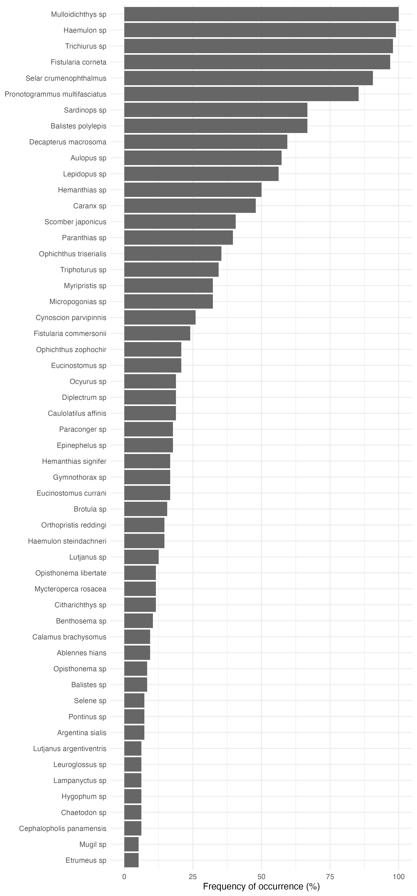
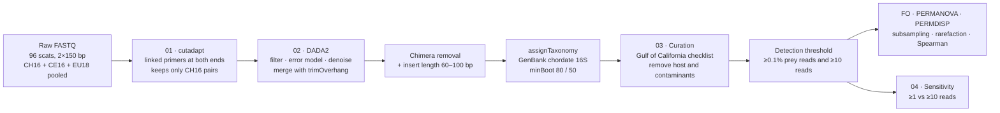

<h1 align="center">🦭 sealion-diet-metabarcoding</h1>

<p align="center">
  <b>Fecal eDNA metabarcoding pipeline for the diet of the California sea lion (<i>Zalophus californianus</i>) in the Gulf of California</b>
</p>

<p align="center">
  <a href="LICENSE"></a>
  
  
  
  
  
  
</p>

---

## Contents

- [Overview](#overview)
- [Key results](#key-results)
- [Pipeline at a glance](#pipeline-at-a-glance)
- [Amplicon and sequencing](#amplicon-and-sequencing)
- [Quick start](#quick-start)
- [Step-by-step parameters](#step-by-step-parameters)
- [Curation and detection rules](#curation-and-detection-rules)
- [Repository structure](#repository-structure)
- [Software](#software)
- [Data availability](#data-availability)
- [How to cite](#how-to-cite)
- [License](#license)

## Overview

This repository contains the complete bioinformatic and statistical workflow behind:

> Mejía-Guarnizo B. N. *et al.* **Fecal eDNA metabarcoding recovers documented temporal dietary patterns in California sea lions (*Zalophus californianus*).** *In review.*

We analysed **96 scats** collected at the Los Islotes colony (Gulf of California) during three periods: post-reproductive 2021 (n = 8), post-reproductive 2022 (n = 23) and reproductive 2022 (n = 65). Prey DNA was amplified with the vertebrate **Chord_16S** primers (mitochondrial 16S rRNA, ~77 bp insert). The pipeline:

1. removes both primers and the adapter read-through at **both ends** of every read;
2. infers ASVs with **DADA2** and assigns taxonomy against a GenBank chordate 16S reference (minBoot 80);
3. applies a **sample-level detection threshold** that guards against cross-contamination and index hopping;
4. computes **frequency of occurrence**, **PERMANOVA**, **PERMDISP**, balanced subsampling, a rarefaction check and a richness–depth correlation.

## Key results

Main analysis: minBoot 80, a prey counted as present when it makes up ≥ 0.1% of the sample's prey reads and has ≥ 10 reads.

| | Value |
|---|---|
| Chordate read pairs → reads in final ASV table | 163.3 M → 143.1 M (87.6%) |
| ASVs | 2,693 |
| Prey reads / prey taxa | 106.6 M / 74 taxa (33 species, 41 genera) |
| Interannual (2021 vs 2022, post-reproductive) | PERMANOVA F = 3.72, R² = 0.114, p = 0.001 · PERMDISP p = 0.73 |
| Seasonal (2022, reproductive vs post-reproductive) | PERMANOVA F = 3.98, R² = 0.044, p = 0.001 · PERMDISP p = 0.26 |

<p align="center">
  
   5%" width="48%">
</p>
<p align="center"><sub>Left: NMDS of prey presence/absence (Jaccard) by period. Right: frequency of occurrence of prey detected in more than 5% of scats.</sub></p>

## Pipeline at a glance



## Amplicon and sequencing

| | Sequence (5'→3') |
|---|---|
| Forward primer (CH16_F) | `CGAGAAGACCCTRTGGAGCT` |
| Reverse primer (CH16_R) | `CCTNGGTCGCCCCAAC` |
| Insert without primers | ~77 bp (main peak 76–79 bp; secondary peak 94 bp, *Ophichthus*) |

- Reads are 2 × 150 bp from an **Illumina HiSeq X** (patterned flow cell, binned quality scores) with dual Nextera XT indices.
- Each library pools three amplicons (chordate **CH16**, cephalopod **CE16**, eukaryote **EU18**). The chordate pairs are recovered by their primers.

> [!IMPORTANT]
> The insert is much shorter than the reads, so every read runs through it into the **opposite primer and the Nextera adapter**. Removing only the 5' primers leaves ~100 bp of primer and adapter in each ASV, which inflates ASV counts and distorts taxonomic assignment. Step 1 removes both.

## Quick start

```bash
git clone https://github.com/taniavaldiviac/sealion-diet-metabarcoding.git
cd sealion-diet-metabarcoding

# full run: raw FASTQ folder, reference FASTA, threads
./run_pipeline.sh /path/to/raw_fastqs /path/to/16S_chor_taxonomy.fasta 8
```

To run the steps one at a time:

```bash
# 1. primer and adapter trimming
#    (raw files named CH-<sample>_S<n>_L001_R[12]_001.fastq.gz)
CUTADAPT=cutadapt ./scripts/01_trim_primers_from_raw.sh raw_fastqs/ work/trimmed/ logs/cutadapt/ 8

# 2. DADA2 and taxonomy (writes results/ and logs/)
Rscript scripts/02_dada2.R work/trimmed/ work/filtered/ . reference/16S_chor_taxonomy.fasta 8

# 3. diet analyses (4th argument: folder with earlier outputs to compare, or NA)
Rscript scripts/03_diet_analysis.R . metadata/sample_metadata.csv metadata/gulf_of_california_fish_checklist.csv NA 999

# 4. sensitivity: >= 1 read vs >= 10 reads
Rscript scripts/04_compare_read_thresholds.R analysis/ metadata/sample_metadata.csv
```

## Step-by-step parameters

| Step | Script | Key parameters |
|---|---|---|
| 1 · Trimming | `scripts/01_trim_primers_from_raw.sh` | Linked adapters `^F...rc(R)` on R1 and `^R...rc(F)` on R2, `-e 0.1`, `--discard-untrimmed --pair-filter=any`, `-m 40` |
| 2 · Filtering | `scripts/02_dada2.R` | No truncation, `maxEE = c(2,2)`, `truncQ = 2`, `maxN = 0`, `minLen = 50`, `rm.phix = TRUE` |
| 2 · Error model | `scripts/02_dada2.R` | `learnErrors` with a loess fit forced to be monotonic (for binned quality scores) |
| 2 · Denoise and merge | `scripts/02_dada2.R` | Per-sample `dada`; `mergePairs(minOverlap = 20, maxMismatch = 0, trimOverhang = TRUE)` |
| 2 · Chimeras and length | `scripts/02_dada2.R` | `removeBimeraDenovo(method = "consensus")`; insert 60–100 bp |
| 2 · Taxonomy | `scripts/02_dada2.R` | `assignTaxonomy(tryRC = TRUE, outputBootstraps = TRUE)`; exported at minBoot **80** (main) and 50 |
| 3 · Diet analyses | `scripts/03_diet_analysis.R` | Jaccard, 999 permutations, prey present in ≥ 5% of samples (also unfiltered); 999 balanced subsamples; rarefaction to 4,000 prey reads |
| 4 · Sensitivity | `scripts/04_compare_read_thresholds.R` | Presence with ≥ 1 read vs ≥ 10 reads (minBoot 80) |
| extra | `scripts/extra/01b_trim_3prime_from_5prime_trimmed.sh` | Alternative to step 1 for reads already trimmed at 5' (used to cross-check step 1) |

## Curation and detection rules

- 🐟 **Checklist:** species-level assignments within Actinopteri that are not in the Gulf of California fish checklist (Robertson *et al.* 2024) are reported at genus level (`Genus sp`).
- 🚫 **Non-prey:** removed taxa are the host (*Zalophus*), humans, domestic vertebrates (*Bos*, *Gallus*, *Sus*, *Canis*) and freshwater taxa (*Oreochromis*). ASVs without a genus assignment are excluded from the prey tables.
- 📏 **Detection thresholds**, applied per sample:

  | Threshold | Rule | Role |
  |---|---|---|
  | original | ≥ 1 read | as in the first version of the manuscript |
  | **strict** | ≥ 0.1% of the sample's prey reads **and** ≥ 10 reads | **main result** |

- 📊 **Comparisons:** two one-factor tests.
  - **Interannual:** post-reproductive 2021 (n = 8) vs post-reproductive 2022 (n = 23).
  - **Seasonal:** reproductive 2022 (n = 65) vs post-reproductive 2022 (n = 23).

  PERMDISP uses `betadisper` + `permutest`. Balanced subsampling draws the larger group down to the size of the smaller one in each of 999 iterations.

## Repository structure

```text
sealion-diet-metabarcoding/
├── run_pipeline.sh                 # runs steps 1–4
├── scripts/
│   ├── 01_trim_primers_from_raw.sh
│   ├── 02_dada2.R
│   ├── 03_diet_analysis.R
│   ├── 04_compare_read_thresholds.R
│   └── extra/01b_trim_3prime_from_5prime_trimmed.sh
├── metadata/
│   ├── sample_metadata.csv         # year, reproductive season, site
│   ├── gulf_of_california_fish_checklist.csv
│   └── primer_data.csv
├── results/                        # ASV table, hash key (.csv/.fasta), taxonomy (minBoot 80/50), bootstraps
├── analysis/                       # prey matrices, FO, PERMANOVA/PERMDISP, subsampling, Spearman, figures
└── logs/                           # read tracking, parameters, quality and error plots, sessionInfo
```

In `analysis/`, files whose names start with `original_` re-analyse the first (2024) pipeline output, for comparison.

## Software

| Tool | Version |
|---|---|
| cutadapt | 4.4 |
| R | 4.3.3 |
| dada2 | 1.28.0 |
| ShortRead | 1.58.0 |
| vegan | 2.6-10 |
| dplyr · tidyr · readr · tibble | 1.1.4 · 1.3.1 · 2.1.5 · 3.2.1 |
| digest | 0.6.37 |

Full session information is in `logs/sessionInfo.txt` and `analysis/sessionInfo.txt`.

## Data availability

| Data | Where |
|---|---|
| Raw reads | SRA/ENA: *accession to be added* |
| Reference database | GenBank chordate mitochondrial sequences, in-silico PCR with Chord_16S (`insect::virtualPCR`), NCBI taxonomy (`taxize`); 142,689 sequences, 21,686 species. Zenodo: *DOI to be added* |

## How to cite

If you use this pipeline, please cite the article (citation to be updated on publication):

```bibtex
@article{mejia_sealion_diet,
  title   = {Fecal eDNA metabarcoding recovers documented temporal dietary patterns
             in California sea lions (Zalophus californianus)},
  author  = {Mej{\'i}a-Guarnizo, Brenda Natasha and others},
  year    = {in review}
}
```

## License

Code is released under the [MIT License](LICENSE).
